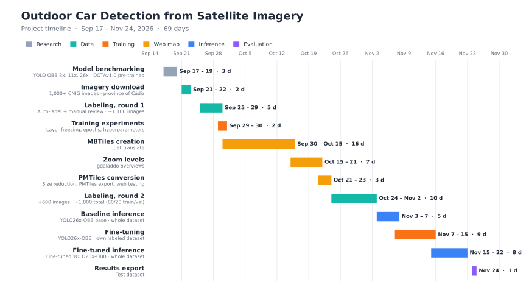

# Introduction

The objective of this project is to improve a Computer Vision AI model to enhance its ability to detect land vehicles using satellite imagery. Potentially identifying areas where parking spaces for vehicles are needed.

That said, the goal of this project is to expand my knowledge of AI and improve my programming skills.

# Methodology

Testing multiple YOLO OBB models (8, 11, 26) I ended up realising that they were bad at recognising cars in the shadows or partially covered.

I finally decided to take YOLO26x-OBB as the base model for this project. But it still fails to detect many cars in pretty clear conditions and good lighting.

Using X-Anylabeling software I use the base model to create a labeling base of all the vehicles in 1 image (1024px * 1024px) and manually modify misplaced labels and adding those missing. 

After labeling many images I needed to finetune the base model with my own dataset.

## Fine-tuning

The process was split between 2 phases:
1. Training 60 epochs with first 10 layers frozen with a reasonable learning rate to change the deep layers of the model based on YOLO26x-OBB model (architecture and weights).
2. Second training 40 epochs with all layers unfrozen and very small learning rate in order to slightly change the head of the model.

# Timeline

# Results

| Model            | mAP50-95 |  mAP50    | Precision |  Recall   |
|:----------------:|:--------:|:---------:|:---------:|:---------:|
| YOLO26x-OBB base | 0.7400   | 0.8283    | 0.8704    | 0.9068    |
| Finetuned model  | 0.8556   | 0.9807    | 0.9667    | 0.9505    |

*<small>Final metrics were evaluated on a dataset of 114 images labeled using YOLO26x-OBB base model and manually adding missing labels.</small>

# Sources

* Satellite images: [CNIG](https://centrodedescargas.cnig.es/CentroDescargas/ortofotos-provisionales-pnoa) (_Centro Nacional de Información Geográfica_)
* Geospatial data [OpenStreetMap](https://www.openstreetmap.org/) and processed by [Geofabrik Gmbh](https://www.geofabrik.de)
